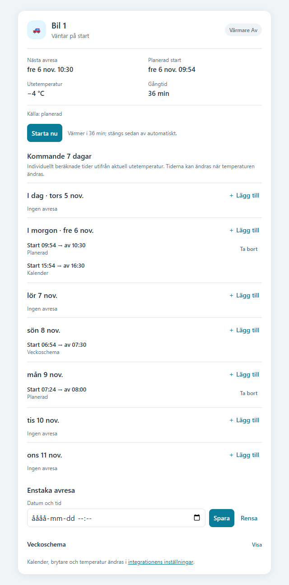

# Engine Heater Card for Home Assistant

English · [Svenska](docs/README.sv.md)

A dashboard card for the engine heater integration. It shows heater status, outdoor temperature, the next departure and estimated start. Start or stop a heating session and plan departures over the next seven days. Multiple departure times can be added to the same day in the car's own calendar. The card follows Home Assistant's English or Swedish language setting.

## Installation

First install the separate [Engine Heater integration](https://github.com/DanneG/ha-motorvarmare) and configure a car with a switch and outdoor sensor. Then add `https://github.com/DanneG/ha-motorvarmare-card` as a custom repository with category **Dashboard** in Marketplace or HACS and install it. Reload the browser, add **Motorvärmare** to a dashboard, and select the car's status entity. Repeat for additional cars.

For manual installation, copy [`dist/ha-motorvarmare-card.js`](dist/ha-motorvarmare-card.js) to `config/www/ha-motorvarmare-card.js`. Add `/local/ha-motorvarmare-card.js` as a JavaScript module under **Settings → Dashboards → ⋮ → Resources**, then reload the browser. Restart Home Assistant if you just created the `www` directory.

## Using the card

The calendar shows each estimated heating period on a seven-day time grid and lets you browse forward. On narrow cards, select a day to see its departures in a compact list. Add one or more departure times per day, as one-time or recurring events. You can edit or remove one local occurrence or an entire series. These are stored in the car's own Home Assistant calendar; Google Calendar is not modified. Google Calendar and weekly-schedule departures can also be displayed. Planned start times use the current outdoor temperature and can change as the temperature changes.

**Start now** runs the heater for the time calculated from the outdoor temperature using [M Sverige's engine-focused recommendations based on Calix](https://msverige.se/allt-om-bilen/service-och-underhall/motorvarmare/). **Stop** cancels a heating session controlled by the integration. The integration chooses no heating above +10 °C and caps heating at 180 minutes below −20 °C; the source does not specify these limits. An active heating session stops above +10 °C. After a temperature stop, scheduled heating can restart at +9.5 °C or below if the departure is still relevant, even after a Home Assistant restart; a manually started session does not restart automatically. An unavailable temperature reading does not stop an active session. In the integration's settings for each car, an optional setting (off by default) keeps scheduled heating running for 30 extra minutes after departure, in addition to the calculated pre-departure heating time. It does not extend **Start now** sessions; the temperature limit still applies. Calendar, outdoor sensor and switch settings are configured in the integration.

If optional power and energy sensors are configured in the integration, the card displays their readings and alerts. See the [energy-monitoring example](docs/preview-energy.png) and the integration instructions for sensor requirements and notification settings.

Open the [heating history](docs/preview-history.png) to see recent sessions and their measured energy when available, plus daily, weekly and monthly summaries. They cover the latest 100 recorded completed sessions. A period crossing, missing energy reading or incomplete coverage is marked; energy from a crossing session is assigned to its end date and can make that period's sum too high. The integration starts collecting history from version 0.7.0.

Test start and stop with the actual equipment. An independent maximum-run timer is recommended in case Home Assistant cannot communicate with the switch.

## License

[MIT](LICENSE).
