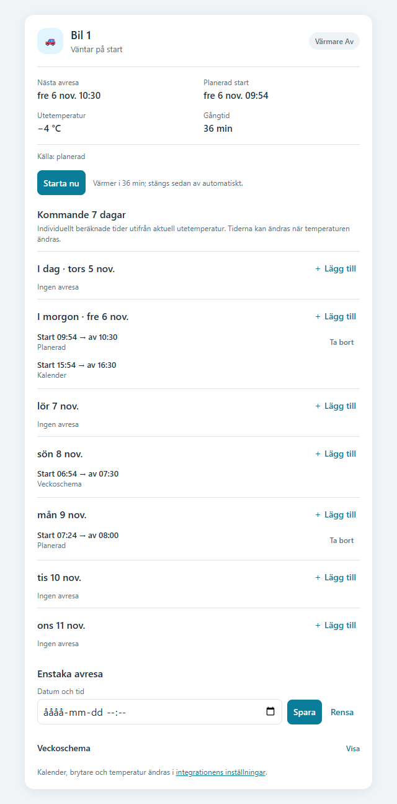

# Motorvärmare – kort för Home Assistant

[English](../README.md) · Svenska

Kortet visar motorvärmarens status, utetemperatur, nästa avresa och beräknad starttid. Du kan starta eller stoppa en uppvärmning och bläddra framåt i kalendern. Flera avresor kan läggas till samma dag i bilens egen kalender. Kortet följer Home Assistants svenska eller engelska språkval.

*Bilden visar en äldre version. Utseendet och värmetiderna i bilden är inte aktuella.*

## Installera

Installera först [Motorvärmare-integrationen](https://github.com/DanneG/ha-motorvarmare) och konfigurera en bil med brytare och utetemperatursensor. Installera sedan `https://github.com/DanneG/ha-motorvarmare-card` som ett eget förråd av typen **Dashboard** i Marketplace eller HACS. Uppdatera webbläsaren, lägg till kortet **Motorvärmare** på en kontrollpanel och välj bilens statusentitet. Upprepa för ytterligare bilar.

För manuell installation: kopiera [`dist/ha-motorvarmare-card.js`](../dist/ha-motorvarmare-card.js) till `config/www/ha-motorvarmare-card.js`, lägg till `/local/ha-motorvarmare-card.js` som en JavaScript-modul under **Inställningar → Kontrollpaneler → ⋮ → Resurser** och uppdatera webbläsaren. Starta om Home Assistant om du just skapade `www`.

För att se flera bilar tillsammans, lägg till **Motorvärmare – översikt** och välj bilarnas statusentiteter i den visuella redigeraren. Tryck på en bil för att öppna dess fullständiga kort; de separata korten finns också kvar.

## Användning

Överst ser du nästa avresa och, när schemat ger underlag, en tidslinje med beräknad start, avresa och stopp. Utetemperatur och gångtid visas också, och gångtiden anges i timmar och minuter. Växla mellan **Kalender**, **Energi** och **Inställningar**. Under **Fler åtgärder** kan du bland annat hoppa över en avresa eller pausa; aktiva pauser och larm är fortsatt synliga.

Tryck på **Öppna kalender** för att se de beräknade uppvärmningarna som block i en större veckokalender och bläddra framåt. Tryck på en tid i rutnätet för att välja en avresetid, eller öppna avreselistan för att se och ändra lokala avresor. På mobilen kan du bläddra i sidled för att se alla dagar. Vyn visar motorvärmarens avresor och beräknade värmeperioder, även från matchade externa kalenderhändelser. På smala kort kan du välja en dag och se dess avresor i en kompakt lista. Lägg till en eller flera engångs- eller återkommande avresetider per dag. Du kan ändra eller ta bort en enskild lokal avresa eller en hel serie. De sparas i bilens egen Home Assistant-kalender; Google Kalender ändras inte. Avresor från Google och veckoschemat kan också visas. Planerade starttider är uppskattningar och kan ändras när temperaturen ändras.

**Starta nu** kör värmaren under den tid som beräknas från utetemperaturen enligt [M Sveriges rekommendationer för motorns bästa utifrån Calix](https://msverige.se/allt-om-bilen/service-och-underhall/motorvarmare/). **Stoppa** avbryter en uppvärmning som integrationen själv styr. Integrationen väljer ingen uppvärmning över +10 °C och högst 180 minuter under −20 °C; källan anger inga tider utanför intervallet. En pågående värmning stoppas över +10 °C. Efter ett temperaturstopp kan schemalagd värmning starta igen vid +9,5 °C eller kallare om avresan fortfarande är aktuell, även efter omstart av Home Assistant; en manuellt startad värmning startar inte om automatiskt. En otillgänglig temperatursensor stoppar inte en pågående värmning. I integrationens inställningar för varje bil finns ett val (avstängt som standard) som låter schemalagd värmning fortsätta i 30 minuter efter avresan, utöver den beräknade uppvärmningen före avresan. Det förlänger inte körningar med **Starta nu**; temperaturspärren gäller fortfarande. Kalender, temperaturgivare och brytare ändras i integrationens inställningar.

Om du väljer en effektsensor i integrationens inställningar visar kortet aktuell effekt, uppskattad energiförbrukning och eventuella varningar. Energin beräknas utifrån effekten över tid; du behöver ingen separat energisensor. Se integrationens instruktioner för sensorkrav och notisinställningar.

I energivyn ser du aktuell effekt, uppskattad energi och sammanfattningar för aktuell dag, vecka och månad när det finns underlag. Öppna historiken för att se tidigare körningar och bläddra bland dagliga, veckovisa och månatliga perioder. De täcker de 1 000 senaste registrerade avslutade körningarna. Saknade mätvärden, ofullständig täckning och körningar som passerar en periodgräns markeras; energin från en sådan körning räknas till slutdatumet och kan ge en för hög summa i slutperioden. Integrationen börjar samla historik från version 0.7.0.

Prova start och avstängning på den faktiska utrustningen. En oberoende maxtimer rekommenderas om Home Assistant inte kan kommunicera med brytaren.

Du kan välja en väderentitet med timprognoser. Kalendern visar då uppskattade tider baserade på prognosen och märker ut källan. Saknas prognos används aktuell uppmätt temperatur. Prognosen påverkar bara visningen: den faktiska styrningen använder fortfarande temperatursensorn. Användarens behörighet till väderentiteten kontrolleras.

Med **Hoppa över nästa** hoppar du över nästa avresa utan att ändra kalendern. Du kan även pausa automatisk värmning per bil och återuppta manuellt eller vid en vald tid. Paus stoppar en schemalagd körning som integrationen styr; en manuellt startad körning styrs separat. Valfria driftlarm varnar för problem med brytare, sensor och kalender i Home Assistant och via vald notismottagare. Gränsen för gammalt temperaturvärde kan ändras; saknad rapporteringstid räknas inte som ett gammalt värde.

Välj vid behov ett fast elpris per kWh eller en prissensor och valuta. Om en sensor är vald används dess pris vid körningens slut; fast pris används inte som tyst reserv om sensorn saknas. Kostnaden är en **uppskattning**, inte en tidsfördelad faktisk elkostnad, och gamla körningar prissätts inte i efterhand. Saknade värden och blandade valutor markeras som ofullständiga.

## Licens

[MIT](../LICENSE).
